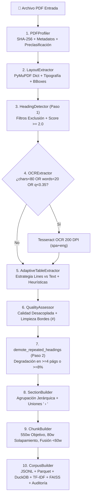

# CIOdD-UCR PDF Intelligence Pipeline (V5.6) — From PDF to RAG & Knowledge Vault

[](https://github.com/agmelendez/pdftorag)
[](LICENSE)
[-success.svg)](docs/ARCHITECTURE.md)
[](docs/COOKBOOK_DUCKDB.md)
[](src/pdf_intelligence/search.py)
[](https://odd.ucr.ac.cr)

> **Centro de Investigación Observatorio del Desarrollo (CIOdD) — Universidad de Costa Rica (UCR)**  
> *Research & RAG Edition — Octubre 2026*  
> Autor y Desarrollador Principal: **Agustín Gómez**

---

## 🌟 Interfaz Metodológica y Portal en Vivo (GitHub Pages)

Accede a la interfaz interactiva y manual metodológico de alto nivel alojado en GitHub Pages para explorar el pipeline, comprender las 10 fases algorítmicas, estudiar la Skill de Agente, explorar los artefactos reales y auditar la comparativa de versiones V5.2 → V5.6:

👉 **[Abrir Portal Metodológico GitHub Pages (`/docs`)](https://agmelendez.github.io/pdftorag/)** *(O abrir localmente [`docs/index.html`](file:///Users/agustingomez/Downloads/0.%20FROM%20PDF%20to%20RAG/docs/index.html) en tu navegador)*.

### Contenidos del Portal Web:
- 📚 **Metodología y Fundamentación**: El problema ontológico del PDF y los 4 pilares epistemológicos del CIOdD-UCR.
- 🔄 **Flujo de Trabajo (10 Fases)**: Inspección de retos, entradas, salidas, formulación algorítmica y código Python de cada fase.
- 🤖 **Skill de Uso para LLMs / RAG**: Protocolo formal (`skills/pdf-intelligence-rag/SKILL.md`) con jerarquía de evidencia de 5 niveles y reglas anti-alucinación.
- 📦 **Especificación de Artefactos**: Diccionario de datos y visor de esquemas canónicos con datos reales del corpus auditado para `chunks`, `tables`, `tables_rejected`, `sections`, `pages` e `integrity_report`.
- 🧹 **Ciclos de Depuración**: Explicación de los filtros heurísticos de saneamiento y microtablas residuales.
- 🧠 **Bóveda de Conocimiento (Brain OS)**: Integración en 4 capas para memoria de largo plazo en Obsidian y agentes de IA.
- 📈 **Evolución V1.0 → V5.6**: Matriz de evolución arquitectónica desde el script original V1.0 hasta la versión modular V5.6.
- 📊 **Comparativa y Versiones (V5.2 → V5.6)**: Matriz comparativa exhaustiva versión por versión, bitácora forense de auditoría empírica, anatomía del bug V5.5 y benchmark interactivo sobre 4 PDFs reales, cuadernos Colab y resultados descargables (`Grok/`).
- ⚡ **Consultas SQL DuckDB**: Cookbook analítico para analistas de datos y LLMs sobre `corpus.duckdb`.
- 💻 **Instalación y CLI**: Guía de despliegue en producción y régimen de licencia no comercial.

---

## 📖 Descripción del Proyecto

El **CIOdD-UCR PDF Intelligence Pipeline V5.6** es una solución integral de ingeniería documental diseñada para transformar bibliotecas heterogéneas de archivos PDF (digitales nativos, escaneados o híbridos) en un **corpus científico estructurado, auditable y con cero pérdida de información**. 

A diferencia de los frameworks RAG genéricos que sufren de alucinaciones de páginas, pérdida silenciosa de secciones cortas y falsas tablas por prosa en columnas, este pipeline implementa un estricto protocolo de 10 fases con verificación criptográfica SHA-256, trazabilidad dual de páginas (índice físico del PDF + etiqueta impresa original) y sanitización tipográfica avanzada (`clean_title`).

---

## 🏗️ Arquitectura y Flujo de Procesamiento

El pipeline procesa cada documento en **10 fases secuenciales** y consolida el corpus en **4 fases globales**:



### Resumen de las 10 Fases
1. **Perfilado (`PDFProfiler`)**: Cálculo de SHA-256, metadatos internos (`pypdf`), clasificación en `digital`, `scanned`, `hybrid` o `empty` mediante muestreo.
2. **Layout Nativo (`LayoutExtractor`)**: Extracción de diccionarios ordenados por lectura, coordenadas bbox, spans tipográficos y mediana de fuente.
3. **Detección de Encabezados (`HeadingDetector`)**: Sistema multicriterio por puntaje ($\ge 2.0$) con filtros de exclusión (notas al pie, viñetas, ejes).
4. **OCR Adaptativo (`OCRExtractor`)**: Renderizado a 200 DPI y extracción con Tesseract bilingüe solo cuando la calidad o volumen nativo es deficiente.
5. **Extracción y Filtro de Tablas (`AdaptiveTableExtractor`)**: Clasificador heurístico que separa tablas genuinas de prosa fragmentada, extrayendo leyendas (caption) y Markdown.
6. **Calidad y Limpieza de Bordes (`QualityAssessor`)**: Normalización de cabeceras/pies a `#` en $\ge 35\%$ de páginas y recorte seguro **solo en bordes**.
7. **Democión de Encabezados Repetidos (`demote_repeated_headings`)**: Degrada encabezados repetidos en $\ge 4$ páginas o $\ge 8\%$ del PDF.
8. **Construcción de Secciones (`SectionBuilder`)**: Estructuración lógica con jerarquías (`" › "`) y procedencia de bloques.
9. **Segmentación en Chunks (`ChunkBuilder`)**: Empaquetado hacia 550 palabras (máx 800), solapamiento intrasección de 80 palabras y **fusión de secciones cortas ($< 60$ palabras)** sin descarte de texto.
10. **Consolidación, Índices y Auditoría (`CorpusBuilder`)**: Exportación a Parquet/JSONL, base `corpus.duckdb`, índices TF-IDF y FAISS, y 9 reglas de integridad.

---

## 📁 Estructura del Repositorio

```text
├── src/
│   └── pdf_intelligence/                <-- Paquete modular de producción (V5.6)
│       ├── __init__.py                  <-- Exportaciones y versionado v5.6.0
│       ├── config.py                    <-- Dataclass PipelineConfig con hiperparámetros V5.6
│       ├── profiler.py                  <-- PDFProfiler (hash SHA-256 y metadatos)
│       ├── layout.py                    <-- LayoutExtractor (bloques, tipografía, bboxes)
│       ├── heading.py                   <-- HeadingDetector blindado y demote_repeated_headings
│       ├── ocr.py                       <-- OCRExtractor (Tesseract OCR adaptativo)
│       ├── tables.py                    <-- AdaptiveTableExtractor (filtro heurístico y microtablas)
│       ├── quality.py                   <-- QualityAssessor y recorte de líneas de borde
│       ├── structure.py                 <-- SectionBuilder y ChunkBuilder (cero pérdida y clean_title)
│       ├── document.py                  <-- DocumentExtractor (orquestador de 10 fases con max_pages)
│       ├── corpus.py                    <-- CorpusBuilder (Parquet, DuckDB, TF-IDF, auditoría)
│       ├── search.py                    <-- LocalSearch (búsqueda rápida sin APIs externas)
│       ├── utils.py                     <-- Normalizadores, clean_title, hashes y serialización
│       └── cli.py                       <-- Interfaz de línea de comandos CLI (dry-run, max-pages)
├── Grok/                                <-- Auditoría empírica, cuadernos e iteraciones V5.3–V5.6
│   ├── ciodd_ucr_pdf_intelligence_pipeline_v5_3.ipynb  <-- Cuaderno Colab V5.3 (Checkpointing)
│   ├── ciodd_ucr_pdf_intelligence_pipeline_v5_4.ipynb  <-- Cuaderno Colab V5.4 (Filtro Prosa)
│   ├── ciodd_ucr_pdf_intelligence_pipeline_v5_5.ipynb  <-- Cuaderno Colab V5.5 (Caso Bug)
│   ├── ciodd_ucr_pdf_intelligence_pipeline_v5_6.ipynb  <-- Cuaderno Colab V5.6 (Final Estable)
│   ├── Documentacion_Tecnica_V5.3.md / V5.5.md / V5.6.md <-- Documentación técnica por versión
│   ├── guia_mejoras_pipeline_v5.6_completa.md          <-- Especificación de portabilidad modular
│   ├── pdf_intelligence_V53/ .. V56/                   <-- Resultados y artefactos generados
│   └── *.pdf                                          <-- 4 PDFs de prueba (257 páginas reales)
├── docs/                                <-- Interfaz Interactiva en GitHub Pages y Guías
│   ├── index.html                       <-- Aplicación web interactiva con Historial V5.6
│   ├── app.js                           <-- Lógica reactiva, benchmark y explorador de artefactos
│   ├── styles.css                       <-- Sistema de diseño limpio con identidad UCR
│   ├── grok/                            <-- Enlace simbólico de acceso directo a Grok/
│   ├── LIMITACIONES_CONOCIDAS.md        <-- Fronteras metodológicas y casos de borde
│   ├── data/
│   │   └── sample_corpus.json           <-- Datos de demostración reales del corpus V5.6
│   ├── ARCHITECTURE.md                  <-- Arquitectura técnica y fórmulas a fondo
│   ├── CODE_REFERENCE.md                <-- Referencia de clases, funciones y métodos
│   ├── OUTPUT_SPECIFICATION.md          <-- Diccionario de datos y especificación de salidas
│   ├── CLEANING_AND_DEBUGGING_CYCLES.md <-- Los ciclos de depuración explicados
│   ├── LLM_AND_RAG_GUIDE.md             <-- Guía de uso, prompts y citación para LLMs
│   ├── BRAIN_OS_INTEGRATION.md          <-- Integración con Bóvedas de Conocimiento (v1.6)
│   ├── EVOLUTION_V1_TO_V5.md            <-- Comparativa histórica V1.0 vs V5.2 vs V5.6
│   └── COOKBOOK_DUCKDB.md               <-- Recetas SQL para consultas analíticas
├── legacy/
│   ├── v1_original/
│   │   ├── pdf_to_rac_json.py           <-- Versión original de hace >1 año (Abril 2026)
│   │   └── README.md
│   └── v5_2_monolith/
│       ├── ciodd_ucr_pdf_intelligence_pipeline_v5_2.py  <-- Monolito Colab Octubre 2026
│       └── README.md
├── tests/
│   ├── test_pipeline.py                 <-- Pruebas unitarias base
│   └── test_v56_regression.py          <-- Pruebas de regresión y blindaje V5.6
├── requirements.txt                     <-- Dependencias de producción core (ligeras)
├── requirements-embeddings.txt          <-- Dependencias opcionales (embeddings + FAISS)
├── requirements-dev.txt                 <-- Dependencias de desarrollo
├── LICENSE                              <-- Licencia Dual: No Comercial + CC BY-NC-SA 4.0
└── README.md                            <-- Documentación principal
```

---

## 🚀 Instalación y Uso Rápido

### 1. Clonar el Repositorio
```bash
git clone https://github.com/agmelendez/pdftorag.git
cd pdftorag
```

### 2. Instalar Dependencias
```bash
# Entorno básico
pip install -e .

# Con soporte opcional para Embeddings densos y FAISS
pip install -e ".[embeddings]"
```

### 3. Procesar un Directorio de PDFs desde la Terminal (CLI)
```bash
pdf-intelligence process --input ./mis_documentos --output ./salida_corpus
```

### 4. Búsqueda Local Rápida con TF-IDF (100% Offline)
```bash
pdf-intelligence search "inteligencia artificial en educación pública" --top-k 5
```

### 5. Auditar Integridad Relacional
```bash
pdf-intelligence audit --output ./salida_corpus
```

---

## 📦 Artefactos de Salida Generados

| Archivo | Formato | Propósito Principal |
|---|---|---|
| `chunks.jsonl` / `.parquet` | JSONL / Parquet | **Unidad primaria para LLMs**. Fragmentos semánticos con citas de página y tablas vinculadas. |
| `tables.jsonl` | JSONL | Tablas genuinas aprobadas, con versión en **Markdown** y diccionarios estructurados. |
| `tables_rejected.jsonl` | JSONL | Rejillas descartadas con motivo explícito (`reject_reason`) para auditoría. |
| `sections.jsonl` / `.parquet` | JSONL / Parquet | Secciones jerárquicas con títulos y procedencia de párrafos. |
| `pages.jsonl` / `.parquet` | JSONL / Parquet | Capas de texto nativo, texto OCR, texto limpio y líneas de borde eliminadas. |
| `documents.jsonl` / `.parquet` | JSONL / Parquet | Catálogo de documentos con métricas de cobertura y calidad. |
| `corpus.duckdb` | Base Relacional | Base relacional indexada para consultas SQL analíticas de alto rendimiento. |
| `tfidf_vectorizer.joblib` / `matrix` | Joblib | Matriz léxica para recuperación local en sub-segundos. |
| `embeddings.npy` / `faiss.index` | Numpy / FAISS | Representaciones vectoriales densas multilingües (384 dimensiones). |
| `integrity_report.json` | JSON | Resultado de 9 controles automáticos de integridad (`PASS` / `FAIL`). |
| `manifest.json` | JSON | Registro reproducible con versiones de librerías y huellas criptográficas SHA-256. |

---

## 🧠 Integración con Bóvedas de Conocimiento (Brain OS v1.6)

El pipeline está diseñado para servir como el motor de ingesta de **Brain OS (Manual de Arquitectura Personal con IA v1.6 por Jaime Figueres)**.
- **Capa 0 (Ingesta Cruda)**: Transforma los PDFs en fragmentos Parquet/JSONL con trazabilidad SHA-256.
- **Capa 1 (Compilador)**: Alimenta notas atómicas en Obsidian y compila tableros interactivos HTML.
- **Capa 2 (Memoria Operativa)**: Los chunks actúan como la memoria de largo plazo (claims) con citas exactas.
- **Capa 3 (Agente Autónomo)**: El agente RAG consulta `corpus.duckdb` para redactar informes y responder preguntas operativas.

Consulta la guía completa en [`docs/BRAIN_OS_INTEGRATION.md`](docs/BRAIN_OS_INTEGRATION.md).

---

## 🧪 Pruebas Unitarias

Para ejecutar el conjunto completo de pruebas unitarias y de regresión automatizadas:
```bash
PYTHONPATH=src python3 -m unittest discover tests
```

---

## 📜 Licencia de Uso, No Comercialización y Atribución

Este proyecto opera bajo un esquema de **Doble Licenciamiento No Comercial con Atribución Obligatoria** para preservar los derechos del autor e impulsar la investigación abierta:

1. **Código Fuente y Software (`src/`, `Grok/`, `tests/`)**:
   - **Permitido**: Clonar, ejecutar, auditar, adaptar y modificar el código para fines académicos, científicos, docentes o personales.
   - **Prohibido**: **Comercializar, vender, revender o sublicenciar** el software o cualquier producto comercial derivado sin autorización previa por escrito del autor.
   - **Atribución Obligatoria**: Si clonas o creas un *fork* de este repositorio, debes mantener visible e inalterable el aviso de autoría original:
     > *"Basado en el CIOdD-UCR PDF Intelligence Pipeline V5.6, desarrollado por Agustín Gómez — Centro de Investigación Observatorio del Desarrollo (CIOdD), Universidad de Costa Rica."*

2. **Documentación, Metodología y Skill de Agente (`docs/`, `skills/`)**:
   - Licenciado bajo **[Creative Commons Atribución-NoComercial-CompartirIgual 4.0 Internacional (CC BY-NC-SA 4.0)](https://creativecommons.org/licenses/by-nc-sa/4.0/deed.es)**.

Consulta los términos jurídicos completos en el archivo **[`LICENSE`](LICENSE)**.

### ✍️ Citación Científica Canónica

Si utilizas este pipeline en tus investigaciones, publicaciones, tesis o benchmarks RAG, por favor cita formalmente:

```bibtex
@software{gomez2026_pdf_intelligence,
  author       = {G{\'o}mez, Agust{\'i}n},
  title        = {{CIOdD-UCR PDF Intelligence Pipeline V5.6: Ingesta no-destructiva, estructuraci{\'o}n profunda y auditor{\'i}a relacional de documentos PDF para RAG}},
  year         = {2026},
  publisher    = {Centro de Investigaci{\'o}n Observatorio del Desarrollo, Universidad de Costa Rica},
  url          = {https://github.com/agmelendez/pdftorag},
  note         = {Licencia Dual: C{\'o}digo No Comercial con Atribuci{\'o}n / Documentaci{\'o}n CC BY-NC-SA 4.0}
}
```
