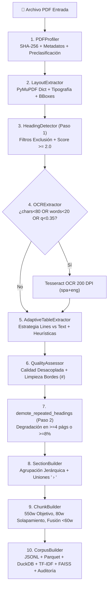

# Arquitectura Técnica del Pipeline: CIOdD-UCR PDF Intelligence V5.6

## 1. Principios Fundamentales de Diseño
El pipeline fue concebido para resolver los defectos sistémicos que afectan a los frameworks comunes de ingestión RAG (como LangChain, LlamaIndex o extractores básicos de PDF) cuando procesan literatura científica, informes técnicos gubernamentales y documentos corporativos heterogéneos:

1. **Cero Pérdida de Texto (`chunk_coverage >= 0.995`)**:
   Ningún párrafo ni sección corta se descarta. Las secciones menores a 60 palabras se fusionan controladamente con el fragmento adyacente o se emiten marcadas como `short_section = True`.
2. **Trazabilidad Bibliográfica Exacta**:
   Separación estricta entre el texto propio de cada fragmento (`unique_words`) y la ventana de solapamiento (`overlap_words`), garantizando que `page_start` y `page_end` reflejen exclusivamente las páginas donde reside la evidencia primaria, junto con su etiqueta impresa (`page_label`).
3. **Control Riguroso de Falsos Positivos Estructurales**:
   Sistema de puntuación multicriterio para encabezados (`HeadingDetector`) con degradación de cabeceras repetidas y clasificador heurístico de tablas (`AdaptiveTableExtractor`) que separa tablas genuinas de prosa fragmentada (`tables_rejected.jsonl`).
4. **Auditoría e Integridad Criptográfica Automatizada**:
   Generación automática de huellas criptográficas SHA-256 de entradas y salidas (`manifest.json`), métricas desacopladas de fiabilidad técnica (`extraction_quality_score`) y verificación de 9 reglas de consistencia relacional (`integrity_report.json`).

---

## 2. Diagrama de Flujo del Pipeline (10 Fases Secuenciales + 4 Globales)

---

## 3. Desglose Fase por Fase

### Fase 1: Perfilado (`PDFProfiler`)
- **Objetivo**: Extraer huella criptográfica SHA-256 inmutable del archivo fuente, recuperar metadatos internos (`pypdf`) y clasificar la naturaleza del PDF.
- **Clasificación**: Muestrea hasta 7 páginas distribuidas uniformemente. Si todas tienen $\ge 20$ palabras es `digital`; si ninguna tiene texto es `scanned`; si es mixto es `hybrid`.
- **Identificador Determinista**: Genera `document_id = "doc_" + sha256(file_sha256)[:16]`.

### Fase 2: Layout Nativo y Tipografía (`LayoutExtractor`)
- **Objetivo**: Extraer la estructura física de la página con `page.get_text("dict", sort=True)`.
- **Métricas**:
  - Aísla bloques de texto (`type=0`) e imágenes (`type=1`).
  - Extrae spans tipográficos con tamaño de fuente, fuente y banderas (`bold`, `flags`).
  - Calcula la mediana tipográfica de la página (`median_font_size`).

### Fase 3: Detección Multicriterio de Encabezados (`HeadingDetector`)
- **Objetivo**: Detectar encabezados estructurales genuinos sin generar falsas secciones por notas al pie, números de ejes de gráficos o viñetas.
- **Reglas de Descalificación**:
  - Longitud $> 20$ palabras o $> 200$ caracteres.
  - Caracteres numéricos $> 35\%$ del texto alfanumérico (ejes de gráficos).
  - Coincidencia con expresiones regulares de notas al pie, citas, viñetas o pies de figura.
  - Paréntesis de cierre desbalanceados (fragmentos de notas de tabla).
- **Sistema de Puntuación**:
  - Coincidencia con estándar (Introducción, Metodología, etc.): $+3.0$
  - Numeración de sección (1.1, 2.3.1): $+2.0$
  - Proporción de fuente respecto a la mediana $\ge 1.30$: $+2.5$ ($\ge 1.18$: $+1.5$)
  - Negrita $\ge 70\%$: $+1.0$
  - Todo mayúsculas: $+1.0$
  - Aceptación: $\text{Puntaje} \ge 2.0$. Confianza: $\min(1.0, \frac{\text{Score}}{4.0})$.

### Fase 4: OCR Adaptativo Dual-Trigger (`OCRExtractor`)
- **Objetivo**: Recuperar contenido en páginas escaneadas o con codificación corrupta.
- **Condición de Disparo**:
  $$\text{Disparar OCR} \iff \text{longitud}(text) < 80 \lor \text{palabras}(text) < 20 \lor \text{text\_quality} < 0.35$$
- **Sustitución**: Se sustituye el texto nativo si el OCR aporta $> 20\%$ más palabras o si el nativo tenía $< 20$ palabras.

### Fase 5: Extracción y Clasificación de Tablas (`AdaptiveTableExtractor`)
- **Objetivo**: Extraer tablas reales y separar prosa en columnas mediante clasificación heurística.
- **Estrategias**:
  1. `lines`: Busca bordes vectoriales explícitos.
  2. `text`: Respaldo para tablas sin líneas (estilo APA).
- **Criterios de Rechazo**:
  - Menos de 2 filas o 2 columnas.
  - Proporción de celdas que inician en minúscula $\ge 0.25$ (indica prosa partida).
  - Celdas vacías $\ge 50\%$.
  - Área ocupada $\ge 70\%$ de la página (prosa en 2 columnas).
- **Salidas**: Las aceptadas van a `tables.jsonl` (con versión Markdown y records); las rechazadas van a `tables_rejected.jsonl` con `reject_reason`.

### Fase 6: Calidad Desacoplada y Limpieza de Bordes (`QualityAssessor`)
- **Objetivo**: Limpiar cabeceras/pies repetitivos sin borrar texto legítimo y calcular fiabilidad técnica.
- **Inferencia de Patrones**:
  - Inspecciona las 3 primeras y 3 últimas líneas de cada página.
  - Normaliza dígitos a `#` (ej. `Informe Anual 2026 - Pág. 12` $\to$ `informe anual #### - pág. ##`).
  - Si un patrón se repite en $\ge 35\%$ de las páginas, se marca como repetitivo.
  - El recorte se aplica **únicamente en los bordes** de la página y se registra en `removed_edge_lines`.
- **Métrica Desacoplada**:
  $$\text{extraction\_quality\_score} = 0.50 \cdot \text{text\_score} + 0.30 \cdot \text{ocr\_score} + 0.20 \cdot \text{encoding\_score}$$

### Fase 7: Democión de Encabezados Repetidos (`demote_repeated_headings`)
- En documentos de $\ge 8$ páginas, degrada encabezados que se repiten en $\ge \max(4, \lceil 0.08 \cdot N \rceil)$ páginas, eliminando cabeceras corridas o etiquetas de tabla repetitivas.

### Fase 8: Construcción de Secciones (`SectionBuilder`)
- Agrupa bloques en unidades semánticas (`{doc_id}_S0001`).
- Une encabezados consecutivos sin texto intermedio: con espacio si están a $< 24$ pt, o con `" › "` si representan jerarquía temática.
- En páginas OCR utiliza directamente `clean_text`.

### Fase 9: Segmentación en Chunks con Cero Pérdida (`ChunkBuilder`)
- Divide párrafos largos ($> 800$ palabras) respetando límites de oraciones.
- Empaqueta texto hacia un tamaño objetivo de 550 palabras (máximo 800).
- Aplica solapamiento intrasección de 80 palabras.
- **Fusión de Secciones Cortas**: Si una sección tiene $< 60$ palabras, se fusiona dentro del chunk anterior registrando `merged_section_ids` y `merged_section_titles`. Nunca se descarta texto.
- **Paginación Exacta**: `page_start` y `page_end` reflejan solo las palabras propias (`unique_words`), excluyendo el solapamiento.

### Fase 10: Consolidación, Índices y Auditoría (`CorpusBuilder`)
- Genera base relacional `corpus.duckdb` cruzando todas las entidades.
- Entrena matriz TF-IDF local (`scikit-learn`) y vectores semánticos multilingües (`SentenceTransformers` + `FAISS`).
- Ejecuta 9 controles de consistencia emitiendo `PASS`, `PASS_WITH_WARNINGS` o `FAIL` en `integrity_report.json`.
- Registra versiones de software y huellas criptográficas en `manifest.json`.
