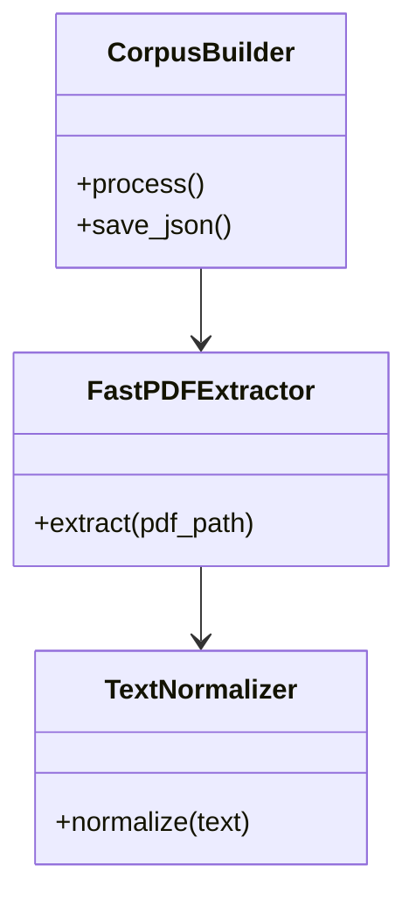
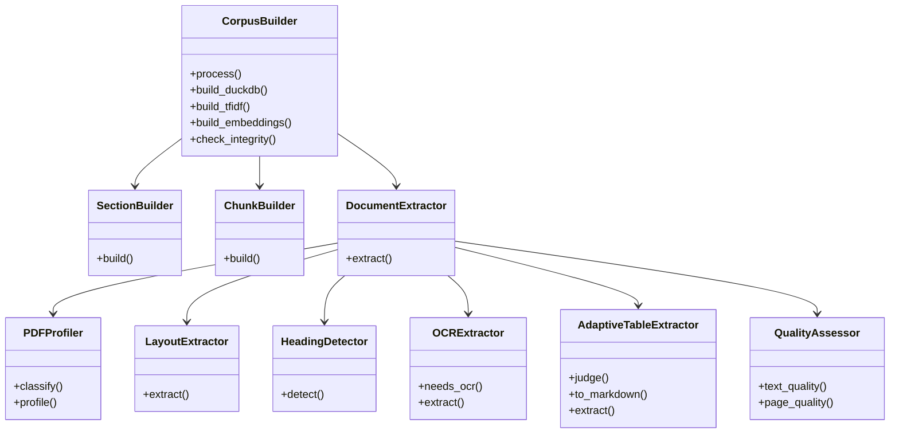

# Evolución Histórica: De `pdf_to_rac_json.py` (V1.0) a V5.2 y V5.6 Estable

Este documento documenta la trayectoria de ingeniería que transformó un prototipo elemental de extracción en un pipeline de nivel de investigación científica para el Centro de Investigación Observatorio del Desarrollo (CIOdD) de la Universidad de Costa Rica.

---

## 1. El Prototipo Original: `pdf_to_rac_json.py` (Versión 1.0 / 4.0, Abril 2026)

El script original [`pdf_to_rac_json.py`](file:///Users/agustingomez/Downloads/0.%20FROM%20PDF%20to%20RAG/legacy/v1_original/pdf_to_rac_json.py) (497 líneas) fue diseñado para ejecución rápida en Google Colab con el objetivo de convertir texto de PDF a JSON sin pasos intermedios. Su arquitectura comprendía 3 clases:

### Fortalezas Iniciales
- **Ligereza y Velocidad**: Procesaba lotes pequeños en 5 minutos.
- **Formato Simple**: Producía `corpus_final.json` directamente consumible.

### Las 9 Fallas Críticas que se Evidenciaron en Producción
Al aplicarse sobre corpus científicos extensos (como el estudio *Children & AI*, 13 PDFs / 863 páginas), se detectaron defectos severos:

1. **Pérdida Silenciosa Masiva**: Toda sección con menos de 60 palabras se descartaba por completo. En un solo informe se perdieron 596 secciones, más de 14.000 palabras de contenido y 36 páginas físicas quedaron sin ningún fragmento en el corpus.
2. **Contaminación de Procedencia de Páginas**: El solapamiento entre fragmentos heredaba la etiqueta de la página siguiente, haciendo que las citas bibliográficas señalaran páginas erróneas.
3. **Alucinación de Falsos Encabezados**: Se clasificaba como encabezado cualquier línea en mayúsculas, notas al pie, numeración de viñetas o ejes de gráficos estadísticos (más de 1.600 secciones artificiales).
4. **Alucinación de Tablas Falsas**: Se generaban más de 800 "tablas" que en realidad eran párrafos de prosa justificada en dos columnas.
5. **Limpieza Destructiva de Números**: Se eliminaban cabeceras de página borrando dígitos numéricos de estadísticas reales dentro de los párrafos.
6. **Desconexión del OCR**: Las páginas procesadas con OCR conservaban los bloques nativos vacíos al construir secciones en vez de utilizar el texto rescatado por Tesseract.
7. **Ausencia de Títulos y Metadatos**: No se inferían títulos de informes ni idiomas.
8. **Métrica de Calidad Distorsionada**: La puntuación de calidad premiaba páginas con tablas o encabezados falsos y penalizaba injustamente portadas o páginas de cierre legítimas.
9. **Sin Auditoría Criptográfica**: Imposibilidad de verificar si el corpus había sufrido alteraciones o si los fragmentos eran reproducibles.

---

## 2. La Transformación en V5.2 (Octubre 2026)

La versión 5.2 refactorizó completamente el sistema en una arquitectura modular de 10 clases especializadas con auditoría criptográfica, base DuckDB y búsqueda híbrida:

---

## 3. Matriz Comparativa Detallada: V1.0 vs V5.2 vs V5.6

| Característica | Versión 1.0 (`pdf_to_rac_json.py`) | Versión 5.2 (`pdf_intelligence` inicial) | Versión Definitiva 5.6 (`pdf_intelligence` estabilizada) |
|---|---|---|---|
| **Líneas de Código** | 497 líneas (monolito) | 2.773 líneas (monolito) / Paquete modular `src/` | Paquete modular robusto `src/` + suite de regresión |
| **Clases de Procesamiento** | 3 clases básicas | 10 clases especializadas | 10 clases especializadas + validación estricta |
| **Garantía de Cobertura** | Descarte silencioso ($< 60$ palabras) | **Cero pérdida** (`chunk_coverage >= 0.995`) | **Cero pérdida blindada** (100% de 85.378 palabras en benchmark) |
| **Paginación** | Página aproximada contaminada por overlap | Paginación exacta sobre palabras propias (`unique_words`) | Paginación exacta con trazabilidad de bloques OCR |
| **Etiqueta Impresa** | No disponible | Doble trazabilidad (`page_number` e índice impreso `page_label`) | Doble trazabilidad persistida en DuckDB y Parquet |
| **Extracción de Tablas** | Cuadrículas crudas sin clasificar | Clasificador heurístico + `tables_rejected.jsonl` | **Filtro dual**: prosa (`max_area=0.85`) + microtablas (`min_area=0.03`) |
| **Detección de Títulos** | Mayúsculas o números sin límite | Detector heurístico $\ge 2.0$ (máx 20 palabras) | **Máx 16 palabras**, sanitización `clean_title` y corrección de orden |
| **Limpieza de Bordes** | Borrado global de cadenas | Patrones con comodín `#` aplicados en bordes | Patrones con comodín `#` aplicados solo en las 3 líneas extremas |
| **Soporte de Base de Datos** | Ninguno (solo archivos JSON) | Base relacional indexada `corpus.duckdb` y Apache Parquet | `corpus.duckdb` optimizado con campos de trazabilidad dual |
| **Búsqueda Integrada** | Ninguna | Búsqueda léxica TF-IDF + Búsqueda densa FAISS (384 dim) | Búsqueda híbrida validada con consultas analíticas SQL |
| **Auditoría e Integridad** | No disponible | `manifest.json` (SHA-256) e `integrity_report.json` (9 reglas) | `manifest.json` + `integrity_report.json` + 0 errores en `errors.jsonl` |
| **Resiliencia Operacional** | Sin checkpoints | Ejecución batch básica | Checkpointing incremental por documento y flags CLI (`--max-pages`, `--dry-run`) |

---

## 4. Evolución Detallada V5.2 → V5.6
Para la comparativa detallada paso a paso de las versiones intermedias de optimización empírica (V5.2 → V5.3 → V5.4 → V5.5 → V5.6), el análisis forense del bug de encabezados y los 4 casos de estudio reales, consulta el portal web en la **Pestaña 8: Comparativa y Versiones (V5.2 → V5.6)** o el archivo de especificación en `docs/LIMITACIONES_CONOCIDAS.md`.
